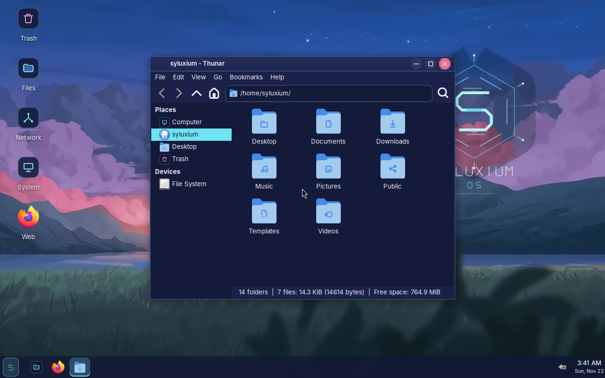
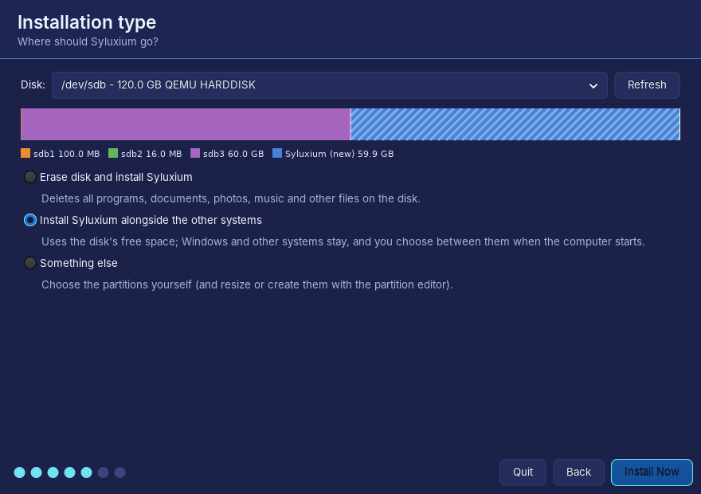
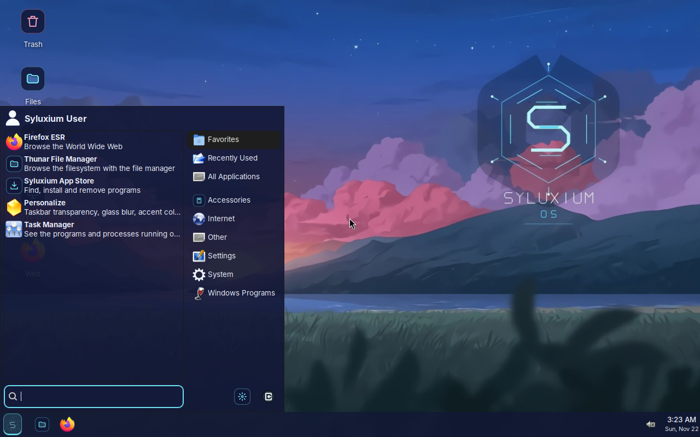
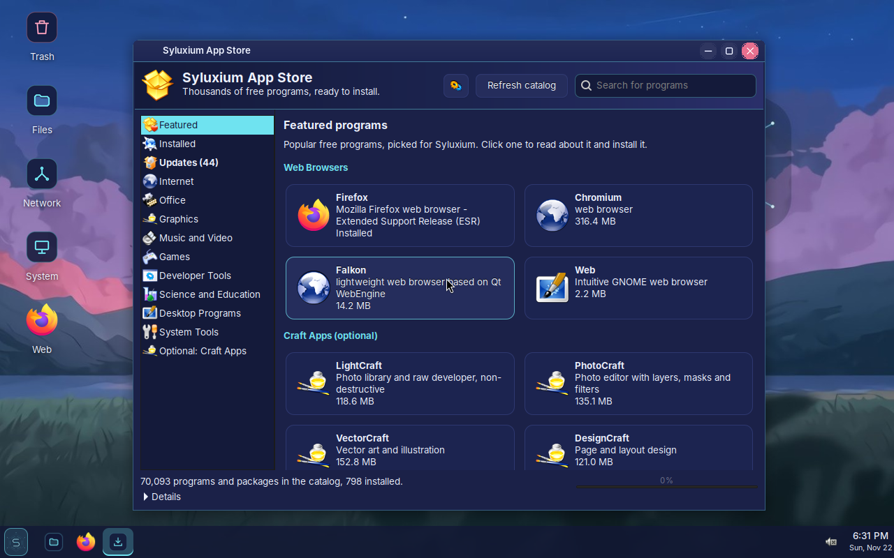
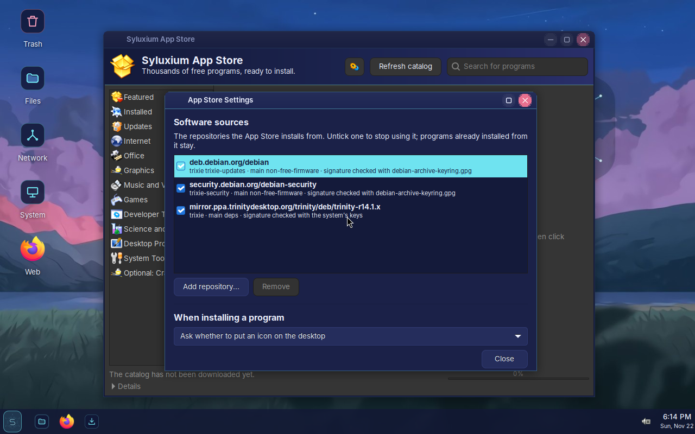

# Syluxium

**A Linux-based operating system with its own desktop, apps and tools**, built on Debian and the
Linux kernel, booted by [Limine](https://github.com/limine-bootloader/limine).

> **Status: beta.** This is the new Linux-based Syluxium. It is tested in virtual machines; testing on
> real hardware (desktop PCs with NVIDIA and AMD graphics) is ongoing.
>
> Looking for the original Syluxium with its **own kernel written from scratch**? It lives on as the
> [`experimental`](https://github.com/Syluxium-Industries/Syluxium-OS/tree/experimental) branch, for
> people interested in operating system development.

Syluxium runs **Linux applications out of the box**: Firefox, Wine, CUPS, apt and the whole Debian
package archive. **Android apps** open as desktop windows (Waydroid), and **Windows programs** run
through Wine.

Highlights:
- **A complete desktop** in Syluxium's own *Dusk* look, built on Xfce: a see-through glass taskbar, a
  start menu with search, rounded windows with real transparency and shadows, adjustable live from
  Personalize, plus a polished login screen, a graphical boot picker and splash.
- **Native Wayland too**: Wayland programs open as ordinary windows in the Xfce desktop (Dusk frames,
  taskbar, clipboard), and a Syluxium shell on the Wayfire compositor (glass panel, blur, Xwayland for
  X11 programs) is in preview alongside it.
- **Hardware support of the Linux kernel**: GPU drivers for AMD, Intel and NVIDIA (NVIDIA's own driver for
  GeForce GTX 750 / 900 series up to RTX 40, picked automatically; nouveau for other cards) with OpenGL
  and Vulkan, Wi-Fi and Bluetooth, laptop audio, touchpads, USB plug and play, with Debian's firmware
  packages included.
- **Android apps**: an Android system (LineageOS through Waydroid) runs in a container; apps get their
  own desktop windows, Start-menu entries and icons; install an `.apk` by double-click or from F-Droid's
  catalogue in the App Store.
- **Ready to use**: a step-by-step installer (alongside Windows too, BIOS and UEFI), App Store and
  updates through apt, Task Manager, Device Manager, Disk Management, recovery mode, and dGPUFG
  (dual-GPU frame generation) preinstalled.
- **Runs from a USB stick**: straight from the stick, collecting boot logs from every machine it's tried on.

## Screenshots

| | |
|---|---|
| **1. Boot picker** (UEFI): pick a system with the mouse or keyboard | **2. Login screen** |
|  |  |
| **3. Desktop** (Dusk theme on Xfce) | **4. Installer**: installation type, next to Windows |
|  |  |
| **5. Start menu**: favourites, categories, search | **6. Terminal** in Dusk colours |
|  |  |
| **7. App Store**: 70,000 Debian packages, featured programs, updates | **8. App Store settings**: software sources on and off, add a repository |
|  |  |

## Made On Linux (Arch / CachyOS)

```sh
sudo pacman -S clang lld make git python mtools util-linux cpio gcc qemu-full kmod dosfstools
sudo pacman -S edk2-ovmf   # optional, for UEFI boots in QEMU
sudo pacman -S docker      # optional, builds NVIDIA's kernel modules (without it: nouveau only)
```

## Build & run

```sh
make image      # the bootable disk image build/syluxium.img
tools/smoke-test.sh [bios|uefi] [seconds] [label]   # boot it headless in QEMU: serial log + screenshot
```

The system is assembled from official Debian trixie packages (`DEBIAN_PKGS` in the Makefile,
downloaded and SHA256-checked by `tools/debian-fetch.py`), including Debian's Linux kernel and
firmware, plus Syluxium's own desktop, apps and tools from `rootfs/`. `tools/mkinitrd.py` makes the
small initrd that finds the system partition; busybox init runs Syluxium's start-up
(`rootfs/etc/inittab`, `rootfs/usr/lib/syluxium/rc.sysinit`).

With a label, the smoke test archives the screenshot and log to `smoke/` (kept locally, not in the
repository). `DESKTOP=1` boots the desktop, `KCMD="..."` boots with other kernel options.

To boot real hardware, write the image to a USB stick
(`sudo dd if=build/syluxium.img of=/dev/sdX bs=4M`). This erases the stick. The stick holds three
partitions: the EFI partition (picker, Limine, the Linux kernel and initrd), SYLUXLOGS (one boot-log
folder per boot and computer: send `syluxium-log.txt` when reporting a problem) and SYLUXLIVE (the
system itself, ext4).

Boot menu (the picker on UEFI machines; **Esc** lists every entry as text):
- **Syluxium**: the desktop
- **Safe mode: no GPU drivers** (`nomodeset`): for display problems (boot option `nonvidia`: nouveau
  instead of NVIDIA's driver)
- **Text console**, **Recovery** (repair disks and packages, reset settings or passwords)
- **Wayland desktop preview**: the Syluxium shell on Wayfire
- **In memory**: the whole system loaded into RAM (for sticks whose ext4 partition is damaged)

## Layout

```
rootfs/               Syluxium's own files: desktop (Dusk theme), apps, tools, start-up, installer
boot/picker/          graphical UEFI boot picker (runs before Limine)
tools/debian-fetch.py downloads official Debian packages (+ dependencies, SHA256-checked)
tools/mkinitrd.py     Syluxium's initrd: finds the system partition (USB, SATA, NVMe, SD, VMs)
tools/nvidia-modules.sh  NVIDIA's kernel modules for Syluxium's kernel (Debian's DKMS build, in Docker)
tools/smoke-test.sh   headless QEMU boot: serial log + screenshot (tools/vfio-run.sh: with a real GPU)
userspace/            test programs and helpers (syluxium-wayland-host: Wayland programs as X windows)
userspace/windows/    Windows test programs (clang + lld-link) for Wine
kernel/               Syluxium's own kernel: the experimental version (not part of this build;
                      see the experimental branch)
```

## Status

Legend: ✅ done · 🟡 partly done · ⬜ to do

- ✅ Boots on the Linux kernel: live USB stick, installed disks (BIOS and UEFI), in memory, safe mode
- ✅ Dusk desktop on Xfce, login screen, boot picker, loading and shutdown screens
- 🟡 Wayland shell (Wayfire): preview
- ✅ Installer: step-by-step, alongside Windows, real progress and "Show details"
- ✅ Network (DHCP, Network Connections, Wi-Fi), sound, USB and input hot-plug
- ✅ Android apps (Waydroid): desktop windows, .apk install, F-Droid in the App Store
- ✅ Windows programs (Wine), App Store, updates through apt, Recovery
- ✅ GPU drivers: AMD (amdgpu, video decoding), Intel, NVIDIA's own driver (550) or nouveau, chosen per card
- 🟡 Real-hardware testing: NVIDIA and AMD desktops in progress
- ⬜ Steam with Proton out of the box (NVIDIA's 32-bit libraries)
- ✅ Diagnostics (hardware and GPU reports, Device Manager) on the Linux kernel

## License

Syluxium is free software, licensed under the **GNU General Public License, version 2 only**
(GPL-2.0-only), the same licence as the Linux kernel. See [LICENSE](LICENSE).

Third-party code keeps its own licence: the Linux kernel and the Debian packages that make up the
system (each under its own licence, listed in `/usr/share/doc/*/copyright` on the system),
[Limine](https://github.com/limine-bootloader/limine) (BSD-2-Clause), and in the experimental kernel
`kernel/` the vendored Linux drivers (`kernel/linuxkpi/`: GPL-2.0, some dual-licensed GPL/BSD or ISC)
and uACPI (MIT).
