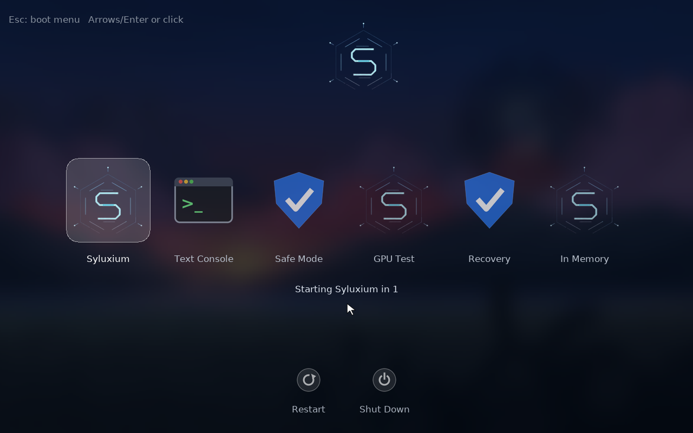
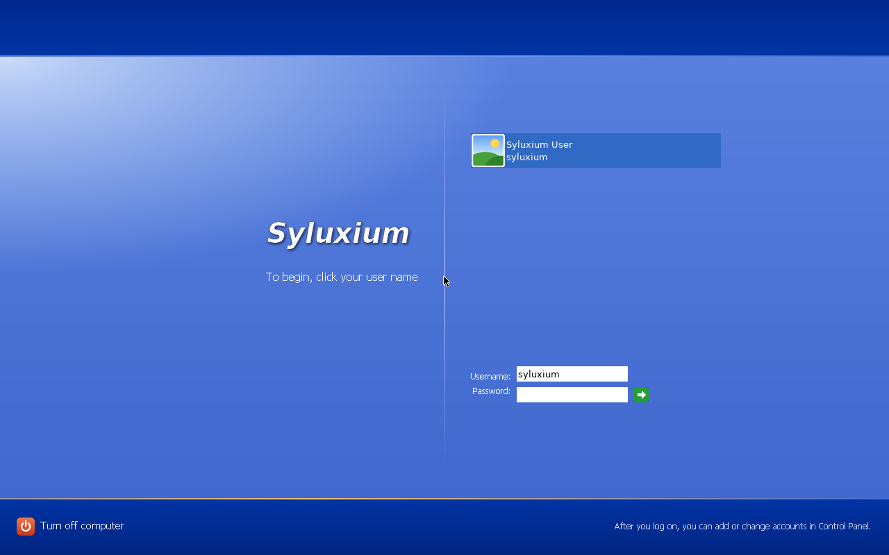

# Syluxium

A from-scratch x86_64 operating system written in C++20: monolithic kernel,
booted by [Limine](https://github.com/limine-bootloader/limine).

## Screenshots

From power-on to the desktop, in the order a computer shows them:

| | |
|---|---|
| **1. Boot picker** (UEFI): pick a system with the mouse or keyboard | **2. Boot splash**: logo and load bar while Syluxium starts |
|  |  |
| **3. Verbose boot** (press Esc during the splash) | **4. Login screen** |
|  |  |
| **5. Desktop** | |
|  | |

## Requirements (Arch / CachyOS)

```sh
sudo pacman -S clang lld make git python mtools util-linux cpio gcc qemu-full
sudo pacman -S edk2-ovmf   # optional, for `make run-uefi`
```

## Build & run

```sh
make            # build/syluxium.elf + bootable disk image build/syluxium.img
make run        # boot in QEMU (BIOS); kernel log also appears in this terminal
make run-uefi   # boot in QEMU with UEFI firmware
make debug      # QEMU waits for GDB:  gdb build/syluxium.elf -ex 'target remote :1234'
```

After the boot self-tests you get an interactive Debian **bash** shell: type in the
QEMU window (PS/2 keyboard) or in the terminal (serial). The userland is built
from official Debian packages (`DEBIAN_PKGS` in the Makefile).

Headless test: `tools/smoke-test.sh [bios|uefi] [seconds] [label]` boots without
a window and captures the serial log + a screenshot. With a label, both are
archived to `smoke/` (one screenshot per major test; survives `make clean`; kept
locally, not in the repository).

The first build clones Limine into `deps/`. `make` also writes
`compile_commands.json`, so CLion / clangd get full code completion
(in CLion: *File → Open* the `compile_commands.json` as a project).

To boot real hardware, write the image to a USB stick
(`sudo dd if=build/syluxium.img of=/dev/sdX bs=4M`). This erases the stick.

Booting: on UEFI machines a graphical **boot picker** comes first (large icons for Syluxium,
Text Console, Safe Mode and any Windows/macOS/Linux found on the disks; arrow keys, Enter,
mouse; Esc = Limine's text menu), then the **boot splash** (logo + load bar) until the login
screen. Press **Esc** during the splash for the verbose boot log. Boot options (Limine entry,
`cmdline:`): `verbose` (no splash), `nodrm` / `xfbdev` (old framebuffer display path), `nogpu`
(no GPU drivers), `noaccel` (GPU driver without acceleration), `acpi=noaml nohz=off idle=hlt`
(safe mode).

## Layout

```
kernel/
  main.cpp            kmain: boot sequence
  linker.ld           higher-half kernel layout
  arch/x86_64/        CPU: GDT/TSS, IDT + ISR stubs, PIC, port I/O, MSRs
  boot/               Limine requests (memory map, framebuffer, HHDM, ...)
  core/               logging (kprintf/klog), panic
  cxx/                freestanding C++ runtime support
  drivers/            device drivers (serial so far)
  lib/                string functions, printf engine, spinlocks
  acpi/               ACPI table parsing (MADT, HPET, ...)
  fs/                 VFS, ramfs, /dev devices, initramfs (cpio) unpacker
  mm/                 memory: pmm (buddy), vmm (page tables), heap (slab), vmalloc
  proc/               processes, user memory (VMAs, demand paging), ELF loader
  sched/              SMP scheduler, threads, mutex/semaphore/completion/wait queues
  syscall/            Linux x86_64 system call layer
  tests/              boot-time self-tests
  time/               clock (TSC/HPET), RTC wall clock
  video/              framebuffer, text console, font, boot splash, /dev/fb0
  linuxkpi/           Linux driver compatibility layer + vendored Linux 6.12 drivers (Wi-Fi, DRM, ...)
boot/picker/          graphical UEFI boot picker (runs before Limine)
userspace/             test programs: built with the host gcc + glibc (static), i.e. real Linux binaries
tools/debian-fetch.py  downloads official Debian packages (+ dependencies, SHA256-checked) into the rootfs
rootfs/               files copied into the initramfs (/etc, ...)
tools/psf2cpp.py      converts a PSF console font into kernel/video/font_*.cpp
tools/smoke-test.sh   headless QEMU boot: serial log + screenshot
tools/wine-setup.sh   finishes Wine in the rootfs: WoW64 DLLs, stripping, template prefix (+ wine-prefix-links.py)
userspace/windows/    Windows test programs (clang + lld-link) for Wine
```

## Checklist

What Syluxium itself has to build. Things Debian already provides and that run
unmodified once the kernel supports them are deliberately left out: glibc,
OpenSSL/GnuTLS, FreeType, GTK/Qt, FFmpeg, PipeWire, Mesa's user-space Vulkan/OpenGL
libraries, browsers, Wine, DHCP/DNS clients, the shell and core utilities.

Legend: ✅ done · 🟡 partly done · ⬜ to do

**Boot**
- ✅ Bootloader (Limine, BIOS + UEFI), 64-bit long mode, GDT/IDT, memory map
- 🟡 ACPI: tables parsed; AML interpreter (port uACPI) for shutdown/sleep/battery still to do

**Kernel core**
- ✅ Memory management, interrupts, APIC timer, preemptive SMP scheduler
- ✅ Processes, user/kernel split, Linux system calls (core set)
- ✅ Pipes, signals
- ✅ User-space threads + futexes
- ✅ Unix domain sockets, shared memory (memfd + seals, POSIX shm, System V shm/semaphores, MAP_SHARED)
- ✅ /proc (process list, per-process CPU/memory, cpuinfo, meminfo, stat) and /sys (CPUs;
     devices come with the phase 5 driver model)
- ✅ 32-bit (ia32) program support
- 🟡 High-resolution timers: ns clock done; precise timer interrupts to do

**Drivers**
- ✅ Serial, PS/2 keyboard, firmware framebuffer
- ✅ PCI/PCIe enumeration (ECAM, BARs, MSI/MSI-X) + device registry (/sys/bus/pci, lspci works,
     /sys/kernel/syluxium/devices for the Device Manager)
- ✅ PS/2 mouse (with wheel)
- ✅ USB (xHCI, USB 2/3 hubs, hot-plug): keyboards, mice, tablets, gamepads, Xbox pads, storage
- ✅ Input event interface (/dev/input/eventN, Linux evdev ABI) for games and the desktop
- ✅ AHCI/SATA, NVMe (polled DMA; interrupts/NCQ later)
- ✅ Wired network cards: Intel e1000/e1000e, virtio-net, RTL8139 (Linux 8139cp), Realtek r8169 (untested)
- 🟡 Linux driver compatibility layer (LinuxKPI): core, PCI, networking, USB, wireless (cfg80211/mac80211), DRM core and page model done; GPU drivers in progress
- 🟡 Wi-Fi: Realtek USB (rtl8xxxu) works with WPA2 and plug and play; MediaTek USB (mt7601u) built in; Intel, Qualcomm, Broadcom, PCIe Realtek/MediaTek to do
- 🟡 Audio: ALSA-compatible interface, Intel HDA, virtio-sound done; USB audio to do
- 🟡 GPU: DRM/KMS core + simpledrm + Xorg modesetting done; Intel i915 builds (hardware bring-up next);
     AMD + NVIDIA drivers, multi-monitor, vsync, Vulkan/OpenGL via Mesa to do

**Storage**
- ✅ VFS, RAM filesystem, initramfs
- ✅ ext2/3/4: reads all three (extents, 64-bit); writes ext2-style volumes (e2fsck-clean).
     ext4 is read-only by design (other systems' Linux partitions stay safe); a journal for
     Syluxium's own volumes (crash safety) is planned before installing on real PCs
- ✅ FAT32 and exFAT read/write with long file names (ESP mounted at /boot/efi)
- ✅ Disk cache (4 KiB blocks, write-back every 5 s and on sync), MBR + GPT partitions

**Networking**
- ✅ TCP/IP stack: Ethernet, ARP, IPv4 + IPv6, ICMP, UDP, TCP (window scaling), DHCP, SLAAC,
     fragments. Drivers: e1000/e1000e, virtio-net, RTL8139 (Linux 8139cp), r8169 (untested)
- ✅ Sockets API: AF_INET/AF_INET6, AF_UNIX (fd passing), AF_NETLINK; epoll, eventfd, timerfd, signalfd, inotify
- ✅ Netlink: rtnetlink (ip, getifaddrs), generic netlink with nl80211 (Wi-Fi)

**Linux compatibility**
- ✅ ELF loader, dynamic linking, Debian userland running unmodified
- 🟡 System-call coverage (grows with every phase)

**Desktop** (Syluxium's own; XP/7 style: clean, rounded, glossy)
- ⬜ Desktop: Trinity (TDE) on Xorg, "Start" text button, XP/7 styling; desktop chooser in the Control Panel (later)
- ⬜ Right-click menus: extract, compress, new file/folder, change icon, properties (TDE: Konqueror + Ark service menus; adapt)
- ⬜ File manager with archive extraction (TDE: Konqueror + Ark)
- ⬜ Display settings: resolution, refresh rate, scaling, multi-monitor (TDE Control Center via XRandR; needs a DRM/KMS driver for mode changes)
- ⬜ Personalize: themes, colors, wallpapers, icons, cursors (TDE: Appearance & Themes)
- ⬜ Control Panel / Settings (TDE Control Center, restyled)
- ⬜ Task Manager with End Task (TDE: KSysGuard; maybe a Windows-style front end)
- ⬜ System page: OS version, CPU, RAM, GPU, storage (TDE: KInfoCenter)
- ⬜ Device Manager
- ⬜ Disk Management, Computer Management
- ⬜ File Explorer, Notepad, WordPad, Paint, Calculator, Character Map, Snipping Tool, Media Player (TDE: Konqueror, KWrite/Kate, KWord, KolourPaint, KCalc, KCharSelect, KSnapshot, Kaffeine/Amarok)
- ⬜ Magnifier, On-Screen Keyboard (TDE: KMag; on-screen keyboard to find)
- ⬜ Network and Sharing Center, Firewall (kernel packet filter + rules UI), Remote Desktop client (TDE: KRDC)
- ⬜ Printing (CUPS-compatible print services, Devices and Printers) (TDE print manager + CUPS)
- ⬜ Programming tools: KDevelop-like IDE (editor, build, gdb debugger front end) (TDE: KDevelop)
- ⬜ Image Writer: flash .iso/.img to USB/SD with verification
- ⬜ Firefox (Debian firefox-esr) preinstalled
- ⬜ Notifications (TDE: KNotify)

**Packages and system**
- 🟡 Package installer: build-time Debian fetcher done; App Store + double-click .deb on the device to do
- ⬜ Running packages' maintainer (install) scripts
- ⬜ Users and permissions (everything runs as root today)
- 🟡 Security: NX, kernel W^X, guard pages done; ASLR, SMEP/SMAP to do
- ⬜ Power management: sleep, battery, CPU frequency scaling
- ⬜ Updates and recovery

Tally: 27 done · 9 partly done · 29 to do.
