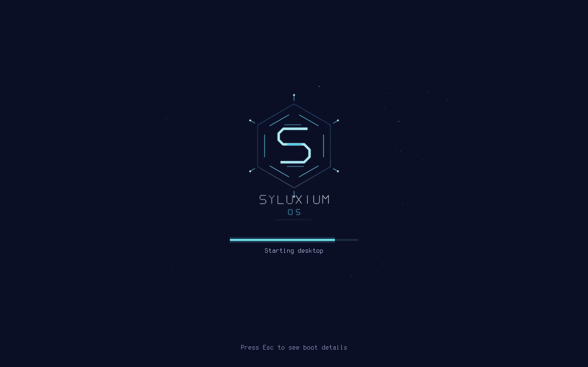
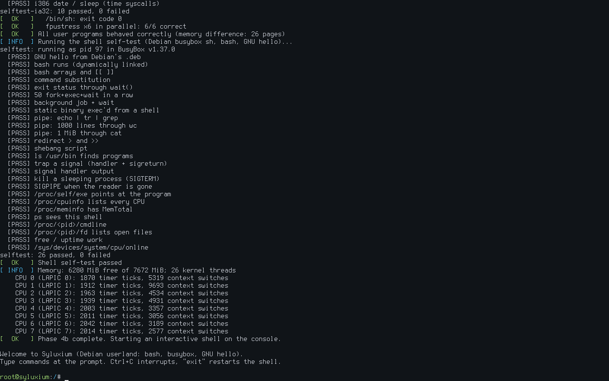
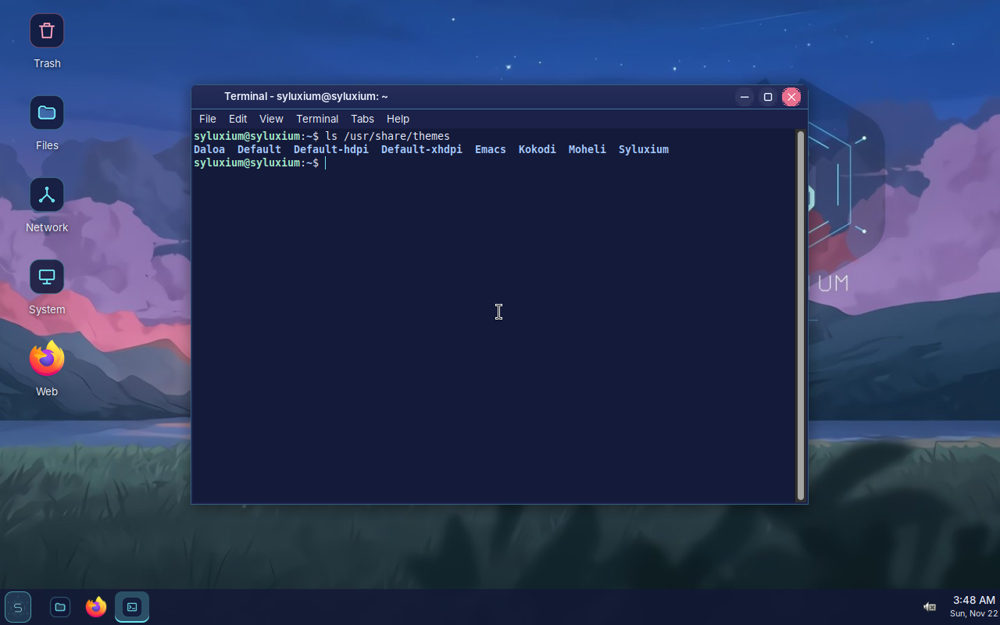

# Syluxium

**A from-scratch x86_64 operating system** written in C, C++20 and Python: its own monolithic kernel,
booted by [Limine](https://github.com/limine-bootloader/limine), aided with AI for a more efficient workflow.

Syluxium runs **Linux applications out of the box**: Firefox, Wine, the Xfce desktop, CUPS, apt and the whole
Debian package archive, unmodified, on top of a kernel written from scratch. **Android app support**
(binder IPC and container support in the kernel, for Waydroid) is being built now.

Highlights:
- **Its own kernel**: SMP scheduler, virtual memory, ext4 with journaling, FAT32/exFAT, a TCP/IP stack
  with IPv6, and the Linux system-call interface, so real Linux binaries run as they are.
- **Real hardware drivers**: USB plug and play, NVMe/SATA, HD audio, touchpads, Wi-Fi with WPA2, and
  Linux 6.12's GPU drivers (Intel, AMD, NVIDIA) through a driver compatibility layer.
- **A complete desktop** in Syluxium's own *Dusk* look, built on Xfce: a see-through glass taskbar, a
  start menu with search, rounded windows with real transparency and shadows, adjustable live from
  Personalize, plus a polished login screen, a graphical boot picker and splash.
- **Native Wayland too**: a Syluxium shell on the Wayfire compositor (glass panel, blur, Xwayland for
  X11 programs) is in preview alongside the Xfce desktop.
- **Ready to use**: a step-by-step installer (alongside Windows too), App Store and updates through apt,
  Device Manager, Disk Management, recovery mode, and Windows programs through Wine.
- **Runs from a USB stick**: boots in seconds straight from the stick, and collects boot logs from
  every machine it's tried on.

## Screenshots

From power-on to the desktop, in the order a computer shows them:

| | |
|---|---|
| **1. Boot picker** (UEFI): pick a system with the mouse or keyboard | **2. Boot splash**: logo and progress bar while Syluxium starts |
|  |  |
| **3. Verbose boot** (press Esc during the splash) | **4. Login screen** |
|  |  |
| **5. Desktop** (Dusk theme on Xfce) | **6. Installer**: installation type, next to Windows |
|  |  |
| **7. Start menu**: favourites, categories, search | **8. Terminal** in Dusk colours |
|  |  |

## Made On Linux (Arch / CachyOS) 

```sh
sudo pacman -S clang lld make git python mtools util-linux cpio gcc qemu-full
sudo pacman -S edk2-ovmf   # optional, for `make run-uefi`
```

## Build & run

```sh
make            # build/syluxium.elf + bootable disk image build/syluxium.img
make run        # boot in QEMU (BIOS); kernel log also appears in this terminal
make run-uefi   # boot in QEMU with UEFI firmware
make debug      # QEMU waits for GDB:  gdb build/syluxium.elf -ex 'target remote :1234'
```

After the boot self-tests you get an interactive Debian **bash** shell: type in the
QEMU window (PS/2 keyboard) or in the terminal (serial). The userland is built
from official Debian packages (`DEBIAN_PKGS` in the Makefile).

Headless test: `tools/smoke-test.sh [bios|uefi] [seconds] [label]` boots without
a window and captures the serial log + a screenshot. With a label, both are
archived to `smoke/` (one screenshot per major test; survives `make clean`; kept
locally, not in the repository).

The first build clones Limine into `deps/`. `make` also writes
`compile_commands.json`, so CLion / clangd get full code completion
(in CLion: *File → Open* the `compile_commands.json` as a project).

To boot real hardware, write the image to a USB stick
(`sudo dd if=build/syluxium.img of=/dev/sdX bs=4M`). This erases the stick. The stick holds three
partitions: the EFI partition (picker, Limine, kernel), SYLUXLOGS (one boot-log folder per boot, so one
stick collects logs from several machines) and SYLUXLIVE (the system itself, ext4, read as needed:
boots don't wait for a big RAM disk to load). The "In Memory" entry loads everything into RAM instead.

Booting: on UEFI machines a graphical **boot picker** comes first (large icons for Text Console,
Default and GPU Test, plus any Windows/macOS/Linux found on the disks; arrow keys, Enter, mouse;
**Esc** lists every entry as text: safe mode, recovery, the Wayland shell, in memory), then the **boot splash** (logo, progress bar and the boot
stage) until the login screen. Press **Esc** during the splash for the verbose boot log. A
desktop that freezes while the kernel still runs: **Alt+PrintScreen+W** writes every thread's
state into the boot log on the stick. Boot options (Limine entry,
`cmdline:`): `verbose` (no splash), `nodrm` / `xfbdev` (old framebuffer display path), `nogpu`
(no GPU drivers), `noaccel` (GPU driver without acceleration), `acpi=noaml nohz=off idle=hlt`
(safe mode).

## Layout

```
kernel/
  main.cpp            kmain: boot sequence
  linker.ld           higher-half kernel layout
  arch/x86_64/        CPU: GDT/TSS, IDT + ISR stubs, PIC, port I/O, MSRs
  boot/               Limine requests (memory map, framebuffer, HHDM, ...)
  core/               logging (kprintf/klog), panic
  cxx/                freestanding C++ runtime support
  drivers/            device drivers (serial so far)
  lib/                string functions, printf engine, spinlocks
  acpi/               ACPI table parsing (MADT, HPET, ...)
  fs/                 VFS, ramfs, /dev devices, initramfs (cpio) unpacker
  mm/                 memory: pmm (buddy), vmm (page tables), heap (slab), vmalloc
  proc/               processes, user memory (VMAs, demand paging), ELF loader
  sched/              SMP scheduler, threads, mutex/semaphore/completion/wait queues
  syscall/            Linux x86_64 system call layer
  tests/              boot-time self-tests
  time/               clock (TSC/HPET), RTC wall clock
  video/              framebuffer, text console, font, boot splash, /dev/fb0
  linuxkpi/           Linux driver compatibility layer + vendored Linux 6.12 drivers (Wi-Fi, DRM, ...)
boot/picker/          graphical UEFI boot picker (runs before Limine)
userspace/             test programs: built with the host gcc + glibc (static), i.e. real Linux binaries
tools/debian-fetch.py  downloads official Debian packages (+ dependencies, SHA256-checked) into the rootfs
rootfs/               files copied into the initramfs (/etc, ...)
tools/psf2cpp.py      converts a PSF console font into kernel/video/font_*.cpp
tools/smoke-test.sh   headless QEMU boot: serial log + screenshot
tools/wine-setup.sh   finishes Wine in the rootfs: WoW64 DLLs, stripping, template prefix (+ wine-prefix-links.py)
userspace/windows/    Windows test programs (clang + lld-link) for Wine
```

## Checklist

What Syluxium itself has to build. Things Debian already provides and that run
unmodified once the kernel supports them are deliberately left out: glibc,
OpenSSL/GnuTLS, FreeType, GTK/Qt, FFmpeg, PipeWire, Mesa's user-space Vulkan/OpenGL
libraries, browsers, Wine, DHCP/DNS clients, the shell and core utilities.

Legend: ✅ done · 🟡 partly done · ⬜ to do

**Boot**
- ✅ Bootloader (Limine, BIOS + UEFI), 64-bit long mode, GDT/IDT, memory map
- ✅ Graphical UEFI boot picker (icons, mouse + keyboard, other systems detected; registers itself in
     the firmware when installed next to another system) and boot splash (progress bar with the boot
     stage; Esc = live verbose log)
- ✅ Runs from the USB stick's ext4 partition (fast start, little RAM); per-boot log folders on the stick
- ✅ ACPI: tables + AML interpreter (uACPI): power off / restart, power button, battery, AC adapter, lid

**Kernel core**
- ✅ Memory management, interrupts, APIC timer, preemptive SMP scheduler
- ✅ Processes, user/kernel split, Linux system calls (core set)
- ✅ Pipes, signals
- ✅ User-space threads + futexes
- ✅ Unix domain sockets, shared memory (memfd + seals, POSIX shm, System V shm/semaphores, MAP_SHARED)
- ✅ /proc (process list, per-process CPU/memory, cpuinfo, meminfo, stat) and /sys (CPUs, PCI
     devices, power supplies)
- ✅ 32-bit (ia32) program support
- ✅ Timers: nanosecond clock, one-shot APIC timer, tickless idle
- ✅ Users and permissions: real/effective user and group IDs, file permissions, sudo

**Drivers**
- ✅ Serial, PS/2 keyboard and mouse (with wheel), firmware framebuffer
- ✅ PCI/PCIe enumeration (ECAM, BARs, MSI/MSI-X) + device registry (/sys/bus/pci, lspci works,
     /sys/kernel/syluxium/devices for the Device Manager)
- ✅ USB: xHCI, EHCI, UHCI, USB 2/3 hubs, plug and play (unplugging never crashes): keyboards,
     mice, tablets, gamepads, Xbox pads, storage, audio, Ethernet, Wi-Fi
- ✅ Input event interface (/dev/input/eventN, Linux evdev ABI) for games and the desktop
- 🟡 Touchpads: Apple USB trackpads (bcm5974, 2008-2015) work; Synaptics, Elantech (with TrackPoint),
     HID precision touchpads over USB and I2C written, to be confirmed on real laptops
- ✅ AHCI/SATA, NVMe (polled DMA; interrupts/NCQ later)
- ✅ Wired network cards: Intel e1000/e1000e, virtio-net, RTL8139 (Linux 8139cp), USB Ethernet
     (CDC-ECM), Realtek r8169 (being replaced by Linux's driver)
- 🟡 Linux driver compatibility layer (LinuxKPI): core, PCI, networking, USB, wireless (cfg80211/mac80211), DRM core and page model done; GPU drivers in progress
- 🟡 Wi-Fi: Realtek USB (rtl8xxxu) works with WPA2, DHCP and plug and play; MediaTek USB (mt7601u)
     built in; Intel (iwlwifi) in progress; Qualcomm, Broadcom, PCIe Realtek/MediaTek to do
- ✅ Audio: ALSA-compatible interface, Intel HDA, virtio-sound, USB Audio (works on real laptops)
- 🟡 GPU: DRM/KMS core, simpledrm, Xorg modesetting with glamor; Intel (i915), AMD (amdgpu, incl.
     Vega and newer, APUs) and NVIDIA (nouveau) drivers run on real machines (NVIDIA renders the desktop);
     virtio-gpu with 3D in VMs (QEMU virgl: glamor, DRI3, OpenGL 4.3 and VA-API on the host's GPU);
     Mesa's Vulkan drivers installed; stability fixes, multi-monitor, Vulkan on real GPUs to do

**Storage**
- ✅ VFS, RAM filesystem, initramfs
- ✅ ext4 read-write with a jbd2 journal (crash safety); ext2/3 too
- ✅ FAT32 and exFAT read/write with long file names (ESP mounted at /boot/efi)
- ✅ Disk cache (4 KiB blocks, write-back every 5 s and on sync), MBR + GPT partitions
- ✅ USB drives mounted automatically, AutoPlay bubble (open folder / play media)

**Networking**
- ✅ TCP/IP stack: Ethernet, ARP, IPv4 + IPv6, ICMP, UDP, TCP (window scaling), DHCP (switchable per
     adapter), SLAAC, fragments, IPv4/IPv6 multicast (group membership, IGMP, loopback).
     Drivers: e1000/e1000e, virtio-net, RTL8139 (Linux 8139cp), r8169 (untested)
- ✅ Sockets API: AF_INET/AF_INET6 (with IP_PKTINFO/TTL ancillary data), raw IPv4, AF_UNIX (fd
     passing), AF_NETLINK, AF_PACKET; epoll, eventfd, timerfd, signalfd, inotify
- ✅ Netlink: rtnetlink (ip, getifaddrs, link/address events with credentials), generic netlink
     with nl80211 (Wi-Fi); /sys/class/net and ethtool (link speed)

**Linux compatibility**
- ✅ ELF loader, dynamic linking, Debian userland running unmodified
- 🟡 System-call coverage (grows with every phase)

**Desktop** (Syluxium's own *Dusk* look: deep navy, the logo's cyan, glass panels)
- ✅ Desktop: Xfce on Xorg in the Dusk theme (original artwork): Dusk window frames with rounded
     corners, compositor transparency and shadows, glass taskbar (transparency adjustable) with the
     hex-logo start menu, pinned apps, window list, tray and clock; Dusk login screen and splash;
     keyboard shortcuts (Win, Win+E/R/D, Ctrl+Esc, Ctrl+Shift+Esc). Trinity stays available as
     "Syluxium Classic" in the login screen
- 🟡 Syluxium shell on native Wayland (Wayfire compositor: glass panel, blur with a GPU driver,
     X11 apps through Xwayland; Android windows next): preview boot entries, rounded corners to do
- ✅ Right-click menus: Extract Here / Extract All, Send To compressed folder, Change Icon
- ✅ File manager: Thunar in Dusk (trash, drives, archives extracted and created)
- 🟡 Display settings: resolution and refresh rate change live (with a 15 s undo); multi-monitor to do
- ✅ Personalize: taskbar and window transparency, shadows, accent colour (applied live), wallpaper;
     works in both the Xfce desktop and the Wayland shell; Dusk icon set
- 🟡 Control Panel: Xfce Settings Manager in Dusk; our own Control Panel to come
- ✅ Task Manager (Ctrl+Alt+Del / Ctrl+Shift+Esc): Applications (End Task, Switch To), Processes
     (End Process, priority), Performance and Networking graphs
- ✅ System page: Syluxium version, processor, memory, graphics, storage
- ✅ Device Manager: every device by category, driver and status, problem devices flagged
- ✅ Computer Management (Event Viewer, Services, Local Users, Device Manager, Disk Management)
     and Disk Management with partitioning and formatting (GParted)
- ✅ Accessories (GTK, in Dusk): Files (Thunar), Terminal (xfce4-terminal), Code Editor (Mousepad),
     WordPad (AbiWord: .rtf, .doc, .docx, .odt), Paint (Drawing), Calculator (galculator), Character
     Map (gucharmap), Snipping Tool (xfce4-screenshooter), Notepad (Wine); Media Player (Kaffeine) and
     E-mail (KMail) from the classic desktop for now; Dusk icons
- ✅ Magnifier, On-Screen Keyboard (KMag, KVkbd)
- 🟡 Networking UI: Wi-Fi chooser by the clock; Network Connections (every adapter's status, IPv4/IPv6
     addresses, gateway, DNS, MAC, link speed; DHCP or static address; enable/disable); firewall
     (needs a packet filter in the kernel) and remote desktop to do
- ✅ Printing: CUPS print service + Printers; network printers found automatically (mDNS / DNS-SD:
     avahi-daemon, cups-browsed adds IPP Everywhere printers to CUPS)
- ⬜ Programming tools: IDE (editor, build, debugger front end)
- ✅ Image Writer: .iso/.img to USB sticks and SD cards with a read-back check
- ✅ Firefox (Debian firefox-esr) preinstalled and the default browser
- ✅ Windows programs: double-click an .exe (Wine)
- 🟡 Android apps: binder IPC and container support in the kernel (for Waydroid) in progress
- ✅ Notifications: Dusk glass bubbles in the lower right for every program (the desktop's
     org.freedesktop.Notifications service: notify-send, Firefox, GTK programs), AutoPlay and Wi-Fi

**Packages and system**
- ✅ Installer: step-by-step wizard (language, keyboard, network, software and updates, installation
     type with a partition view: erase / alongside Windows / manual, time-zone map, account) → GPT +
     ext4 + Limine (UEFI/BIOS)
- ✅ App Store: Debian and desktop packages by category, search, featured programs, install/remove
     with dependencies (apt), updates; double-click a .deb to install it; optional Craft apps
     (LightCraft, PhotoCraft, VectorCraft, FilmCraft and 12 more, from their makers' .deb releases)
- ✅ Packages' install scripts run (real dpkg database; apt works)
- ✅ Accounts: graphical login, User Accounts (add/remove users, passwords), administrator prompts
- 🟡 Security: NX, kernel W^X, guard pages, per-user permissions done; ASLR, SMEP/SMAP to do
- 🟡 Power management: power off / restart, power button, battery icon, lid switch, idle CPU states,
     CPU frequency scaling (AMD); sleep (S3) to do
- ✅ Updates (Syluxium Update: Debian packages through apt) and a Recovery boot entry
     (repair disks and packages, reset settings or passwords, root prompt)

Tally: 48 done · 12 partly done · 2 to do.
